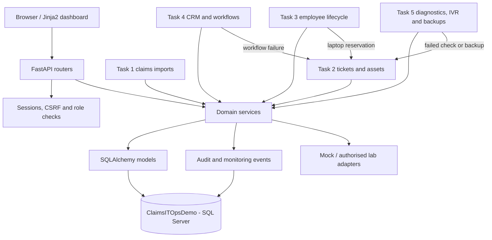

# Northstar Claims Ltd — IT Operations Automation & Support Management Platform

**A five-module IT support and workflow automation portfolio project built with Python, FastAPI, Microsoft SQL Server, PowerShell and Windows.**

Northstar Claims Ltd is a **fictional UK claims-management company**. This application models the sort of work performed by an IT Support Engineer, Windows Systems Administrator and IT Automation Developer: importing business data, resolving helpdesk requests, managing devices and employee access, troubleshooting CRM workflows, diagnosing workstation/network issues, reviewing call activity and planning backup recovery.

> [!IMPORTANT]
> **Portfolio / laboratory software — not a production-ready business system.** All company names, customers, accounts, telephone records and sample devices are fictional. Active Directory and Google Workspace operations are simulated by default; Zoho CRM uses a mock client; IVR calls are simulated; network diagnostics are restricted to approved targets. Do not deploy the supplied demonstration credentials or enable optional real integrations against production services.

## Contents

- [What the platform does](#what-the-platform-does)
- [Technology stack](#technology-stack)
- [How the modules work together](#how-the-modules-work-together)
- [Repository structure](#repository-structure)
- [Prerequisites](#prerequisites)
- [Deploy locally on a fresh Windows 11 computer](#deploy-locally-on-a-fresh-windows-11-computer)
- [Upgrade an existing installation](#upgrade-an-existing-installation)
- [Configuration and security](#configuration-and-security)
- [Application pages and API](#application-pages-and-api)
- [Demonstrating the five modules](#demonstrating-the-five-modules)
- [SQL Server backup and isolated restore](#sql-server-backup-and-isolated-restore)
- [Optional isolated integration labs](#optional-isolated-integration-labs)
- [Automated tests and verification](#automated-tests-and-verification)
- [Running as a persistent local demo](#running-as-a-persistent-local-demo)
- [Troubleshooting](#troubleshooting)
- [Publish to GitHub](#publish-to-github)
- [Interview demonstration](#interview-demonstration)
- [Limitations and future improvements](#limitations-and-future-improvements)

## What the platform does

| Module | Features | What it demonstrates |
| --- | --- | --- |
| **Task 1 — Claims data** | Excel/CSV import, normalisation, validation, duplicate prevention, rejected-row reasons, batch audit trail, Excel reporting | SQL Server, data quality, Python automation, transactional imports |
| **Task 2 — Helpdesk and assets** | Support tickets, technician assignment, priorities, SLAs, troubleshooting history, laptop/desktop/printer/network-device inventory, device assignment and return | Desktop support workflows, IT service management, role-based permissions |
| **Task 3 — Employee lifecycle** | Onboarding/offboarding forms, checklists, approval history, department groups, laptop reservations, AD plans, Google Workspace mock accounts | Identity administration, controlled provisioning, separation of duties |
| **Task 4 — Claims CRM** | Claims dashboard, Zoho CRM V8 mock/opt-in real clients, workflow rules, event idempotency, failure retries, template previews, Excel analytics | REST integration, OAuth, workflow automation, observability |
| **Task 5 — Infrastructure operations** | Allowlisted IP/DNS/TCP diagnostics, read-only Windows health, mock call logs and IVR, backup verification, support-incident escalation | TCP/IP, Windows/PowerShell, security monitoring, telephony concepts, recovery procedures |

### Key engineering features

- **One application and one database:** all five tasks share FastAPI, SQLAlchemy, the `ClaimsITOpsDemo` SQL Server database and a common audit trail.
- **Security boundaries:** local Admin / Technician / Employee roles, Argon2id password hashes, signed browser sessions, CSRF checks and server-side authorisation.
- **Repeat-safe workflows:** unique claim references, import file-hash detection, conflict-safe asset assignments and event idempotency keys.
- **Visibility:** rejected imports, ticket timelines, provisioning actions, CRM failures, network test history, backup results and linked IT incidents.
- **Safe demonstration defaults:** simulated cloud/phone integrations, read-only workstation checks, network target allowlists and guarded backup restoration.
- **Testability:** an isolated SQLite-backed pytest suite, including an end-to-end test spanning all five modules. The **latest packaged baseline passed 59 tests**. Windows/SQL Server integration must also be checked locally.

## Technology stack

| Area | Technology |
| --- | --- |
| Backend | Python 3.12, FastAPI, Pydantic, SQLAlchemy |
| Database | Microsoft SQL Server Express, SQL Server Management Studio (SSMS), Microsoft ODBC Driver 18, pyodbc |
| Frontend | Jinja2, HTML, CSS, JavaScript |
| Data imports and exports | pandas, openpyxl, CSV, JSON, ZIP archives |
| Identity and sessions | Argon2id (`argon2-cffi`), `itsdangerous`, signed HTTP-only cookies |
| Windows automation | PowerShell 5.1+, Windows networking/Defender cmdlets, optional `sqlcmd` |
| External API demonstrations | Zoho CRM V8 REST/OAuth; Google Admin SDK Directory API (opt-in lab); Active Directory PowerShell (opt-in lab) |
| Testing | pytest, FastAPI TestClient / httpx, SQLite test fixtures |
| Developer tools | VS Code, Git, PowerShell |

## How the modules work together



**Design:** `app/routers/` handles web/API requests; `app/services/` contains business logic; `app/models.py` defines the shared relational schema; `app/db.py` manages the SQL Server connection; `app/security.py` enforces sessions and roles; `scripts/` contains schema, seed and maintenance utilities.

### Access roles

| Role | Typical permissions |
| --- | --- |
| **Admin** | Manage users, employee lifecycle approvals, claims imports, workflow rules, IVR configuration and application backup exports |
| **Technician** | Work on assigned tickets, manage supported inventory records, review permitted diagnostics and operational monitoring |
| **Employee** | Submit and view their own support tickets |

Permissions are enforced in FastAPI, not merely by hiding controls in the browser.

## Repository structure

```text
it-operations-platform/
├── app/
│   ├── main.py                  # FastAPI app and router registration
│   ├── config.py                # Environment and SQL Server options
│   ├── db.py                    # SQLAlchemy / pyodbc session creation
│   ├── models.py                # Shared models for Tasks 1–5
│   ├── security.py              # Authentication, sessions, CSRF and RBAC
│   ├── schemas.py               # Task 2 request/response schemas
│   ├── employee_schemas.py      # Task 3 validation
│   ├── workflow_schemas.py      # Task 4 validation
│   ├── operations_schemas.py    # Task 5 validation
│   ├── routers/                 # Claims, tickets, assets, employees, CRM, operations
│   ├── services/                # Imports, business rules, integrations and reporting
│   ├── templates/               # Jinja2 browser pages
│   └── static/                  # CSS and JavaScript
├── scripts/
│   ├── 01_create_database.sql
│   ├── 03_task2_migration.sql
│   ├── 05_task3_migration.sql
│   ├── 07_task4_migration.sql
│   ├── 09_task5_migration.sql
│   ├── 11_sqlserver_full_backup.sql
│   ├── 12_restore_only_to_lab.sql
│   ├── *_checks.sql             # SSMS validation queries
│   ├── init_schema.py
│   ├── migrate_task2.py ... migrate_task5.py
│   ├── seed_task2.py ... seed_task5.py
│   └── generate_*.py            # Fictional data generators
├── powershell/
│   ├── Invoke-NorthstarAD.ps1
│   ├── Get-NorthstarWindowsHealth.ps1
│   └── Invoke-NorthstarSqlBackup.ps1
├── sample_data/                # Fictional Excel, CSV and JSON fixtures
├── tests/                      # Unit, API, permission and integration tests
├── docs/                       # Architecture, lab and interview guides
├── .env.example                 # Safe configuration template
├── .gitignore                   # Ignores local secrets and backup files
├── requirements.txt
├── requirements-google-lab.txt # Optional Google API client libraries
├── pytest.ini
└── README.md
```

The exact contents of every folder are available in the repository; the task-specific architecture guides live in [`docs/`](docs/).

## Prerequisites

This README targets **Windows 11, PowerShell and a local SQL Server Express named instance**. A Windows Server domain and cloud subscriptions are **not** needed to use the default mock demos.

Install:

1. **[Python 3.12 (64-bit)](https://www.python.org/downloads/windows/)** — enable the Python launcher.
2. **[Visual Studio Code](https://code.visualstudio.com/download)** — install the Python extension.
3. **[SQL Server Express](https://www.microsoft.com/en-us/sql-server/sql-server-downloads)** — use a named instance `SQLEXPRESS`, with Windows Authentication.
4. **[SQL Server Management Studio](https://learn.microsoft.com/en-us/ssms/install/install)** — for creating, inspecting, backing up and restoring databases.
5. **[Microsoft ODBC Driver 18 for SQL Server](https://learn.microsoft.com/en-us/sql/connect/odbc/download-odbc-driver-for-sql-server)** — 64-bit to match Python.
6. **[Git for Windows](https://git-scm.com/download/win)** — for GitHub version control.

Optional: the [Microsoft `sqlcmd` utility](https://learn.microsoft.com/en-us/sql/tools/sqlcmd/sqlcmd-utility) for scripted SQL backups, and a separate isolated Windows Server/Active Directory or FreePBX lab.

Verify installation in **PowerShell**:

```powershell
py -3.12 --version
git --version
Get-Service 'MSSQL$SQLEXPRESS'
```

The SQL Server service should be `Running`. If the instance has a different name, update `DB_SERVER` accordingly.

## Deploy locally on a fresh Windows 11 computer

> [!NOTE]
> These steps are for a **new** `ClaimsITOpsDemo` database. If you already have the Tasks 1–4 database and records, use [Upgrade an existing installation](#upgrade-an-existing-installation) instead.

### 1. Download the project and open it in VS Code

Clone your GitHub repository after publishing it, or download and extract the project ZIP. Open the directory containing `app/`, `scripts/` and `requirements.txt` in VS Code (**File → Open Folder**).

Open **Terminal → New Terminal**, select **PowerShell**, and run all commands from the **project root**.

### 2. Create the Python environment

```powershell
py -3.12 -m venv .venv
Set-ExecutionPolicy -Scope Process -ExecutionPolicy Bypass
.\.venv\Scripts\Activate.ps1
python -m pip install --upgrade pip
python -m pip install -r requirements.txt
```

The execution-policy change applies **only to this PowerShell process**, not the whole computer.

Confirm your connection driver:

```powershell
python -c "import pyodbc; print(pyodbc.drivers())"
```

Expected: the output contains `ODBC Driver 18 for SQL Server`.

### 3. Create a private local configuration

```powershell
Copy-Item .env.example .env
python -m scripts.configure_local
```

This creates a `.env` file and generates a random `APP_SECRET_KEY`. Keep `.env` **out of Git**.

For the default local installation, check these settings in `.env`:

```dotenv
DB_SERVER=localhost\SQLEXPRESS
DB_NAME=ClaimsITOpsDemo
DB_ODBC_DRIVER=ODBC Driver 18 for SQL Server
DB_ENCRYPT=yes
DB_TRUST_SERVER_CERTIFICATE=yes
APP_COOKIE_SECURE=false
ZOHO_MODE=mock
ZOHO_REAL_ENABLED=NO
GOOGLE_LAB_ENABLED=NO
OPS_DNS_TARGETS=localhost
OPS_TCP_TARGETS=localhost:8000
OPS_LAB_TARGETS_ENABLED=NO
OPS_HEALTH_MODE=mock
```

Do **not** paste your generated signing key or any cloud credentials into GitHub. `DB_TRUST_SERVER_CERTIFICATE=yes` is intended only for a trusted **local test** server with a self-signed certificate. Use certificate validation for a real deployment. `APP_COOKIE_SECURE=false` is for **localhost HTTP** only.

### 4. Create the database using SSMS

1. Start **SQL Server Management Studio**.
2. Connect to `localhost\SQLEXPRESS` using **Windows Authentication**. For the local self-signed test certificate, enable **Trust server certificate** if SSMS requires it.
3. Select **File → Open → File** and open `scripts/01_create_database.sql`.
4. Press **F5**. Confirm that `ClaimsITOpsDemo` exists and is online.
5. Back in the VS Code terminal, run:

```powershell
python -m scripts.init_schema
```

This creates the **current full Tasks 1–5 schema** from the shared SQLAlchemy models. On a brand-new database, **do not then run historical Task 2–5 incremental migrations**; those scripts are for upgrading earlier databases.

### 5. Generate safe sample data and seed demonstration records

```powershell
python -m scripts.generate_sample_data
python -m scripts.generate_task5_calls
python -m scripts.seed_task2
python -m scripts.seed_task3
python -m scripts.seed_task4
python -m scripts.seed_task5
```

The seed scripts generate fictional users, devices, tickets, templates, workflow rules, call logs and IVR rules. They are designed to avoid duplicating already seeded records.

Sample files include:

- `sample_data/northstar_claims_1000.xlsx` and `.csv` — 1,000 fictional claims, with valid rows, duplicates and intentionally invalid data.
- `sample_data/task4_demo_claims.csv` — two claims for workflow demonstrations.
- `sample_data/task4_zoho_mock.json` — CRM test responses.
- `sample_data/task5_call_logs.csv` — 60 fictional calls.
- `sample_data/task3_ad_plan.json` — approved fictional AD plan.

**Note:** Generating a sample file does not automatically import its claims into SQL Server. Use the browser import page as described below.

### 6. Start FastAPI

```powershell
python -m uvicorn app.main:app --reload --host 127.0.0.1 --port 8000
```

Expected console output includes:

```text
Uvicorn running on http://127.0.0.1:8000
Application startup complete.
```

Open **http://127.0.0.1:8000/login**. API documentation is available at **http://127.0.0.1:8000/docs** and the lightweight health endpoint is **http://127.0.0.1:8000/health**.

Stop the server with **Ctrl+C**.

### 7. Sign in with a fictional account

| Demo role | Username | Password for the local demo only |
| --- | --- | --- |
| Admin | `admin` | `NorthstarAdmin!2026` |
| Technician | `tech.owen` | `NorthstarTech!2026` |
| Technician | `tech.maya` | `NorthstarTech!2026` |
| Employee | `employee.ellie` | `NorthstarStaff!2026` |
| Employee | `employee.jamie` | `NorthstarStaff!2026` |
| Independent offboarding approver | `admin.reviewer` | `NorthstarReview!2026` |

These are **hard-coded fictional seed credentials**, intended for a local disposable environment. They are **not safe for a shared network or internet-facing deployment**. Change or remove them before any wider access.

## Upgrade an existing installation

If you already have Task 1, 2, 3 or 4 data, **do not create a new database and do not run `init_schema` in place of the upgrade migration**. Back up both your project directory and your SQL Server database first. Preserve the existing `.env` and signing key.

Apply **only the missing migrations, in order**. For example, if upgrading directly from Task 1:

```powershell
python -m scripts.migrate_task2
python -m scripts.migrate_task3
python -m scripts.migrate_task4
python -m scripts.migrate_task5
```

If upgrading from Task 4, run **only**:

```powershell
python -m scripts.migrate_task5
```

Each migration also has an SSMS counterpart:

| Target | SQL script | Python alternative |
| --- | --- | --- |
| Task 2 | `scripts/03_task2_migration.sql` | `python -m scripts.migrate_task2` |
| Task 3 | `scripts/05_task3_migration.sql` | `python -m scripts.migrate_task3` |
| Task 4 | `scripts/07_task4_migration.sql` | `python -m scripts.migrate_task4` |
| Task 5 | `scripts/09_task5_migration.sql` | `python -m scripts.migrate_task5` |

Execute a given migration **once through SSMS or Python, not both simultaneously**. Use its corresponding `04_`, `06_`, `08_` or `10_` check script afterward. These are **additive laboratory migrations**; they have not been validated as a general-purpose production migration framework.

After migrating, install the updated requirements, seed any newly added demo modules and restart FastAPI.

## Configuration and security

Configuration is loaded from `.env` with `python-dotenv`. The tracked [`.env.example`](.env.example) contains no passwords or tokens.

| Variable | Purpose | Local default/example |
| --- | --- | --- |
| `DB_SERVER` | SQL Server host/instance | `localhost\SQLEXPRESS` |
| `DB_NAME` | Shared application database | `ClaimsITOpsDemo` |
| `DB_ODBC_DRIVER` | ODBC driver name | `ODBC Driver 18 for SQL Server` |
| `DB_ENCRYPT` | Enable SQL connection encryption | `yes` |
| `DB_TRUST_SERVER_CERTIFICATE` | Local self-signed certificate trust | `yes` (lab only) |
| `MAX_UPLOAD_MB` | Claims upload size limit | `5` |
| `APP_SECRET_KEY` | Signs application sessions | Generated locally; **never commit** |
| `APP_COOKIE_SECURE` | Require HTTPS for auth cookie | `false` for localhost HTTP |
| `ZOHO_MODE`, `ZOHO_REAL_ENABLED` | Select mock versus explicitly enabled real CRM | `mock`, `NO` |
| `ZOHO_REGION`, `ZOHO_API_BASE_URL`, `ZOHO_MODULE` | Region, base URL and module mapping | `EU`, regional HTTPS URL, `Claims` |
| `ZOHO_FIELD_*` | Match API names in a test CRM module | See `.env.example` |
| `GOOGLE_LAB_ENABLED` | Opt-in Google Workspace lab utility | `NO` |
| `OPS_DNS_TARGETS` | Allowed DNS names | `localhost` |
| `OPS_TCP_TARGETS` | Allowed TCP host:port pairs | `localhost:8000` |
| `OPS_LAB_TARGETS_ENABLED` | Permit explicitly configured private lab targets | `NO` |
| `OPS_HEALTH_MODE` | Mock or fixed read-only Windows checks | `mock` |
| `OPS_BACKUP_DIR` | Private recovery-export location | Optional; default project `backups/` |

For real Zoho experiments, OAuth client ID/secret and refresh tokens must be supplied **outside source control**, with a lab-only Zoho tenant and narrowly scoped permissions. The mock mode needs none of them. The optional Google Directory utility similarly does not need credentials in mock mode.

Other safeguards:

- Passwords are stored as **Argon2id hashes**; sessions are signed and time-limited (8 hours).
- Mutating authenticated API requests require the **`X-CSRF-Token`** header in addition to the session cookie. Browser forms provide it automatically.
- Authentication and Admin/Technician/Employee checks run on the server.
- Claims imports validate file types, values and uniqueness. Excel exports avoid treating arbitrary cell text as formulas.
- The network diagnostic API refuses non-allowlisted destinations and arbitrary network scans.
- No FastAPI endpoint can trigger a live AD change, Google account change, real telephone call or SQL database restore.
- Recovery exports, `.bak` files, credentials and locally generated `.env` files are excluded by `.gitignore`; check your commits nevertheless.

## Application pages and API

### Web dashboards

| Page | URL | Main purpose |
| --- | --- | --- |
| Login | `/login` | Signed-in sessions |
| Main dashboard | `/` | Claims intake and platform overview |
| Helpdesk | `/tickets` | Create, assign and resolve tickets |
| Asset inventory | `/assets` | Inventory management and assignment |
| Employee Management | `/employees` | Onboarding, offboarding, approvals and reservations |
| Claims Management | `/claims-management` | CRM-linked claim status and missing documentation |
| Workflow Logs | `/workflow-logs` | Workflow executions, failures and retries |
| Communication Templates | `/communication-templates` | Preview/edit claims messages (no emails sent) |
| Operations | `/operations` | Network, health, call, IVR and backup monitoring |
| OpenAPI docs | `/docs` | Interactive API reference |
| Service health | `/health` | Simple application-process health response |

`/health` reports whether the FastAPI process responds; it is **not** a full database or infrastructure readiness check.

### Representative REST endpoints

| Method | Endpoint | Example |
| --- | --- | --- |
| `POST` | `/api/auth/login` | Create a signed session and obtain CSRF token |
| `POST` | `/api/claims/import` | Import claims XLSX/CSV (Admin) |
| `GET` | `/api/claims` | List imported claims |
| `GET` | `/api/imports` | Import batches and rejection diagnostics |
| `GET` | `/api/reports/claims.xlsx` | Claims workbook |
| `GET`, `POST` | `/api/tickets` | List or create support tickets |
| `POST` | `/api/tickets/{ticket_id}/assign` | Assign a technician |
| `PATCH` | `/api/tickets/{ticket_id}` | Update ticket status and resolution |
| `GET`, `POST` | `/api/assets` | Find/register inventory |
| `POST` | `/api/assets/{asset_id}/assign` | Assign a device |
| `POST` | `/api/assets/{asset_id}/return` | Return a device |
| `POST` | `/api/employees/onboarding` | Prepare an employee onboarding request |
| `POST` | `/api/employees/{employee_id}/offboarding` | Request suspension workflow |
| `POST` | `/api/employees/offboarding/{request_id}/approve` | Independent Admin approval |
| `GET` | `/api/reports/tickets.xlsx` | Ticket report |
| `GET` | `/api/reports/inventory.xlsx` | Inventory report |
| `GET` | `/api/reports/workload.xlsx` | Technician workload |
| `POST` | `/api/workflows/events` | Process a CRM workflow event |
| `GET` | `/api/workflows/executions` | Workflow history |
| `POST` | `/api/workflows/executions/{execution_id}/retry` | Retry a failed workflow (Admin) |
| `GET` | `/api/reports/claims-workflows.xlsx` | Claims workflow workbook |
| `POST` | `/api/operations/network/check` | Approved IP/DNS/TCP diagnostics |
| `POST` | `/api/operations/health/check` | Mock or read-only Windows health |
| `POST` | `/api/operations/calls/import` | Upload fictional CSV call logs |
| `POST` | `/api/operations/ivr/simulate` | Simulate an IVR route |
| `POST` | `/api/operations/backups/export` | Create a data recovery ZIP |
| `POST` | `/api/operations/backups/{job_id}/verify` | Check backup export integrity |

Other routes, exact request models and role requirements are documented interactively at `/docs`.

**Authenticated PowerShell API example:**

```powershell
$base = 'http://127.0.0.1:8000'
$session = New-Object Microsoft.PowerShell.Commands.WebRequestSession
$login = Invoke-RestMethod -Uri "$base/api/auth/login" -Method Post `
  -WebSession $session -ContentType 'application/json' `
  -Body (@{ username='admin'; password='NorthstarAdmin!2026' } | ConvertTo-Json)
$headers = @{ 'X-CSRF-Token' = $login.csrf_token }
Invoke-RestMethod -Uri "$base/api/auth/me" -WebSession $session
Invoke-RestMethod -Uri "$base/api/operations/calls/stats" -WebSession $session
```

Use `$headers` for authenticated `POST`, `PATCH`, `PUT` and other mutating requests. For security, avoid storing or echoing session cookies and secrets in terminal logs.

## Demonstrating the five modules

### Task 1 — Claims import and Excel reports

1. Sign in as `admin` and open `/`.
2. Upload `sample_data/northstar_claims_1000.xlsx`.
3. On an empty claims database, expect **1,000 rows processed: 900 imported and 100 rejected** (40 deliberate duplicates, 60 invalid rows).
4. Review import history, rejected-row reasons and claims data.
5. Upload the same file again and demonstrate the existing-batch/idempotency result.
6. Download the Excel claims report; inspect its summaries and formulas in Excel.

### Task 2 — Helpdesk and device inventory

1. Sign in as `employee.ellie`, then submit a **Hardware** ticket: “Laptop crashes on startup.”
2. Sign in as Admin and assign the ticket to `tech.owen`.
3. Sign in as Owen, change status to **In Progress**, add troubleshooting notes, and resolve it with documented steps.
4. Open `/assets` to view the linked laptop and demonstrate conflict-safe assignment/return.
5. View ticket history, priority, SLA state and the Excel ticket/workload reports.

### Task 3 — Fictional onboarding and offboarding

1. In `/employees`, prepare onboarding for **Alex Morgan**, Claims Handler, selecting a permitted claims security group and a laptop.
2. Observe the SQL provisioning checklist, an AD command plan, mock Google account/group actions and a reserved available laptop.
3. Activate the *local demonstration record*; this does **not** prove an account was created in real AD or Google Workspace.
4. Request offboarding and use **`admin.reviewer`** to approve it. A requester cannot approve their own departure request.
5. Review mock suspension actions, access flags, equipment return state and audit history.

### Task 4 — Zoho CRM and workflow automation

1. As Admin, import `sample_data/task4_demo_claims.csv` using the Task 1 claim import.
2. Open `/claims-management`; use the mock CRM record for `NCL-009999`.
3. Demonstrate **New → Assigned → Evidence Required → Ready for Review → Resolved**.
4. Inspect `/workflow-logs`, including claim references, before/after stages, execution status and retry count.
5. For a training failure, show the automatically raised Task 2 support ticket and Admin-only retry action.
6. Preview a communication template and download `/api/reports/claims-workflows.xlsx`.

The bundled `scripts/demo_task4.ps1` automates the example lifecycle in mock mode after the claim has been imported.

### Task 5 — Network, device health, telephone and backups

1. Open `/operations` as Admin or Technician.
2. Run a DNS lookup for **`localhost`** and a TCP check for **`localhost:8000`** with FastAPI running. Inspect elapsed times and history.
3. Click **Capture health**. The default demo produces fictional Windows security information; Windows mode uses fixed read-only cmdlets where available.
4. Review or import the 60 fictional call records, and simulate **Main → digit 1 → ClaimsQueue**.
5. Export selected claims/tickets/assets to a ZIP, verify its SHA-256/integrity information, and simulate a harmless backup failure.
6. Open the linked Task 2 incident. No real phone call, network scan or database restore is executed by the website.

## SQL Server backup and isolated restore

**There are two distinct backup concepts:**

1. **Application recovery export:** an authenticated Admin can export selected tables as JSON in a ZIP archive. The system records checksums, verifies the file and logs the result. This is **not a native SQL Server `.bak`** and does not replace full database backups.
2. **SQL Server full backup:** a standalone, operator-initiated SSMS/PowerShell laboratory script backs up `ClaimsITOpsDemo` with `CHECKSUM` and runs `RESTORE VERIFYONLY`.

### Create a full SQL backup in an authorised local lab

1. On the computer hosting SQL Server, create `C:\NorthstarLabBackups`.
2. Grant write permissions to the **SQL Server service identity** (not just your interactive Windows account).
3. In SSMS, review and run `scripts/11_sqlserver_full_backup.sql`.
4. Verify that `C:\NorthstarLabBackups\ClaimsITOpsDemo_full.bak` exists and that the script's verification and backup-job logging succeeded.

PowerShell preview and execution commands:

```powershell
.\powershell\Invoke-NorthstarSqlBackup.ps1
# Only after explicit approval on a local test instance:
.\powershell\Invoke-NorthstarSqlBackup.ps1 -Execute
```

`-Execute` requires `sqlcmd` and a valid local SQL Express setup.

### Restore safely to a separate test database

In SSMS, inspect the backup first:

```sql
RESTORE FILELISTONLY
FROM DISK = N'C:\NorthstarLabBackups\ClaimsITOpsDemo_full.bak';
```

Run `scripts/12_restore_only_to_lab.sql` in its **default inspection mode**. Its explicit confirmation gate stops the restore until you approve the test, and it only targets the distinct `ClaimsITOpsRestoreLab` database. Review the logical file names and source layout; only then follow the script's lab-only confirmation instructions. It refuses an existing restore database and will **not overwrite `ClaimsITOpsDemo`**.

Finally compare counts:

```sql
SELECT COUNT(*) AS source_claims FROM ClaimsITOpsDemo.dbo.claims;
SELECT COUNT(*) AS restored_claims FROM ClaimsITOpsRestoreLab.dbo.claims;
```

`RESTORE VERIFYONLY` alone is **not proof of successful disaster recovery**. A completed and inspected restore to a separate database is the meaningful additional check. Never test restoration over the working database.

### Windows Task Scheduler (optional lab exercise)

Use **Task Scheduler → Create Task**, choose an authorised local service identity, and configure **Start a program**:

- Program: `powershell.exe`
- Arguments: `-NoProfile -NonInteractive -ExecutionPolicy Bypass -File "C:\Path\To\it-operations-platform\powershell\Invoke-NorthstarSqlBackup.ps1" -Execute`
- Start in: your absolute project directory

Test the task manually, inspect **Last Run Result**, verify the `.bak`, and review `dbo.backup_jobs`. The demonstration script uses a **fixed backup filename and overwrites the previous `.bak`**; production backup scheduling needs separate retention, encrypted off-host copies, monitoring and tested recovery objectives. **Never schedule the restore script.**

## Optional isolated integration labs

These are optional demonstrations; **none is required for the standard application or automated tests**.

| Lab | Default | Separate prerequisites and instructions |
| --- | --- | --- |
| **Active Directory** | Plan/dry-run only | Isolated Windows Server AD DS domain, RSAT ActiveDirectory PowerShell module, delegated test permissions; see `powershell/Invoke-NorthstarAD.ps1` and [`docs/TASK3_ARCHITECTURE.md`](docs/TASK3_ARCHITECTURE.md) |
| **Google Workspace** | Mock Directory client | Isolated Workspace tenant, approved domain-wide delegation and Admin SDK Directory API scopes; optional packages in `requirements-google-lab.txt` |
| **Zoho CRM V8** | MockZohoClient | Test CRM tenant, configured region/module/field API names and OAuth secrets supplied outside source control |
| **Network diagnostics** | `localhost` only | Explicitly permitted private lab targets in `.env`; see [`docs/NETWORK_LAB.md`](docs/NETWORK_LAB.md) |
| **FreePBX/Asterisk** | Simulated IVR | Separate host-only VM; no SIP trunk or real calls; see [`docs/PHONE_LAB.md`](docs/PHONE_LAB.md) |

**Active Directory dry-run from PowerShell:**

```powershell
.\powershell\Invoke-NorthstarAD.ps1 -PlanPath .\sample_data\task3_ad_plan.json
.\powershell\Invoke-NorthstarAD.ps1 -PlanPath .\sample_data\task3_ad_plan.json -Action InspectUser
.\powershell\Invoke-NorthstarAD.ps1 -PlanPath .\sample_data\task3_ad_plan.json -Action InspectGroups
.\powershell\Invoke-NorthstarAD.ps1 -PlanPath .\sample_data\task3_ad_plan.json -Action DisableAccount
```

It prints **`DRY RUN`** and makes no AD changes. Lab mode additionally enforces domain/OU allowlists, `-WhatIf` as a default and explicit change approval.

**Google Workspace mock mode:**

```powershell
python -m scripts.google_workspace_lab --action create
python -m scripts.google_workspace_lab --action list
python -m scripts.google_workspace_lab --action group
python -m scripts.google_workspace_lab --action update
python -m scripts.google_workspace_lab --action suspend
```

To install the **optional** Google client packages for an isolated lab:

```powershell
python -m pip install -r requirements-google-lab.txt
```

Consult the task architecture guides and the standalone lab script before considering any opt-in real operation. Never store service-account credentials or OAuth tokens inside the repository.

## Automated tests and verification

From an activated Python virtual environment in the project root:

```powershell
python -m pytest -q
python -m pytest -v
python -m pytest tests/test_task5_full_platform.py -v
python -m compileall -q app scripts tests
```

**Expected baseline:** 59 passing tests in the latest packaged Task 5 repository. The end-to-end test spans claims import, an asset reservation, a staff ticket, CRM workflow processing, a failed network check with incident escalation, application backup verification and shared audit history.

The test suite intentionally uses **SQLite and mocked integrations**, so it runs without SQL Server, a domain controller, Google Workspace or Zoho credentials. Passing tests do **not** certify that a real Windows/ODBC/SQL Server integration, actual SQL backup/restore or external API lab configuration works; validate those separately.

### SQL Server checks in SSMS

After fresh setup or migration, use the bundled scripts:

- `scripts/02_reporting_queries.sql` — claims and duplicates.
- `scripts/04_task2_checks.sql` — helpdesk and inventory.
- `scripts/06_task3_checks.sql` — employee lifecycle.
- `scripts/08_task4_checks.sql` — CRM/workflow history.
- `scripts/10_task5_checks.sql` — operations monitoring.

Simple cross-module verification:

```sql
USE ClaimsITOpsDemo;
GO
SELECT COUNT(*) AS Claims FROM dbo.claims;
SELECT COUNT(*) AS Tickets FROM dbo.tickets;
SELECT COUNT(*) AS Assets FROM dbo.assets;
SELECT COUNT(*) AS Employees FROM dbo.employees;
SELECT COUNT(*) AS Workflows FROM dbo.workflow_executions;
SELECT COUNT(*) AS Calls FROM dbo.call_logs;
SELECT COUNT(*) AS MonitoringEvents FROM dbo.monitoring_events;
```

## Running as a persistent local demo

For day-to-day portfolio use, the supported deployment is the loopback-only Uvicorn development server:

```powershell
.\.venv\Scripts\Activate.ps1
python -m uvicorn app.main:app --host 127.0.0.1 --port 8000
```

Omit `--reload` when leaving the local demo running. SQL Server Express must be running and accessible under the Windows account launching the process because the database connection uses **Windows Integrated Authentication**.

To launch on login for a personal, isolated workstation, Windows Task Scheduler can start the virtual environment's `python.exe` with arguments `-m uvicorn app.main:app --host 127.0.0.1 --port 8000` and **Start in** set to the project directory. The task's Windows identity needs the appropriate SQL Server permissions. This is only a convenience for a **local demo**, not a hardened production hosting architecture.

> [!WARNING]
> **Do not simply change the bind address to `0.0.0.0` and publish this demonstration service to the internet.** Before a real shared deployment, remove seeded accounts/passwords and fictional hard-coded assumptions, use HTTPS and secure cookies, apply network controls, use a dedicated least-privilege SQL login/service identity, implement deployment-grade migrations, secret management, audit retention, monitoring, stronger account controls and security review. Live AD/Google/Zoho/phone integration requires separate authorisation and validation.

## Troubleshooting

| Symptom | Cause or resolution |
| --- | --- |
| `py -3.12` not found | Install Python 3.12, reopen terminal and confirm Python launcher. |
| Virtual environment activation blocked | Run `Set-ExecutionPolicy -Scope Process -ExecutionPolicy Bypass`, then activate `.venv`. |
| `ModuleNotFoundError` | Activate `.venv`, run `python -m pip install -r requirements.txt`, launch from project root. |
| ODBC driver not found | Install matching 64-bit Microsoft ODBC Driver 18; inspect `pyodbc.drivers()`. |
| SQL Server connection timeout | Start `SQL Server (SQLEXPRESS)` service; verify `DB_SERVER`, instance name and Windows permissions. |
| SQL TLS certificate error | For a **trusted local-only** instance, use the example self-signed certificate settings; use validated TLS for deployments. |
| `Invalid object name` | Missing initial schema/migration or wrong `DB_NAME`; follow the fresh-versus-upgrade database path. |
| `APP_SECRET_KEY not configured` | Run `python -m scripts.configure_local`, preserving any existing private `.env`. |
| `401 Login required` | Sign in and retain the session cookie. |
| `403` or `CSRF` error | Check role permissions and send the login response's `X-CSRF-Token` on mutations. |
| `422` or import rejects | Inspect JSON validation detail/rejected-row reasons and input formats. |
| Workflow doesn't run | Seed rules with `python -m scripts.seed_task4`; inspect `/workflow-logs` for conditions and failures. |
| TCP/DNS target blocked | Use exactly the host or host:port in the configured allowlist; arbitrary network scanning is intentionally unavailable. |
| Defender status unavailable | Windows Defender cmdlets may be unavailable or another antivirus may be installed; the application reports unknown/unavailable. |
| Call imports are duplicates | Already seeded/imported call references are intentionally ignored. |
| Backup access denied | Check NTFS permissions for the **SQL Server service identity** and the configured local backup location. |
| `sqlcmd` unavailable | Install `sqlcmd`, or run the `.sql` backup script directly in SSMS. |
| Restore confirmation stops execution | Expected safe default; review the lab-only instructions, backup logical files and approval gate. |

For more detail see the relevant SQL `*_checks.sql`, API responses, ticket/monitoring logs and task-specific documentation.

## Publish to GitHub

1. Keep only **fictional** sample data. Remove any real customer, employee, phone or claims information from the repository.
2. Check [`.gitignore`](.gitignore). In particular, `.env`, `.venv/`, `backups/`, `*.bak`, database files, logs and OAuth/service-account credentials must remain untracked.
3. Review the staged file list **before** your first push. If a secret was previously committed, adding `.gitignore` does not remove it from Git history: revoke the credential and remediate Git history before publishing.
4. Create a new GitHub repository (e.g. `northstar-it-operations-platform`). Choose **Private** while reviewing security and documentation, and switch to Public only when safe.

In VS Code PowerShell, run from the project root:

```powershell
git init
git add .
git status
git diff --cached --name-only
git commit -m "Initial Northstar IT Operations portfolio project"
git branch -M main
```

Then add the **actual HTTPS clone URL from your new GitHub repository** and push:

```powershell
git remote add origin https://github.com/YOUR_GITHUB_USERNAME/northstar-it-operations-platform.git
git push -u origin main
```

Replace `YOUR_GITHUB_USERNAME` with your username; do **not** paste real tokens or passwords into shell commands. Authenticate via Git Credential Manager or GitHub's supported authentication flow. If Git is not configured, set `git config --global user.name` and `git config --global user.email` first.

GitHub displays this root-level `README.md` automatically on the repository homepage.

### What to add to a portfolio listing

**Project summary:** “Built a five-module Python/FastAPI and SQL Server IT operations platform covering data imports, helpdesk ticketing and asset inventory, simulated AD/Google onboarding, CRM workflow monitoring, Windows diagnostics, call logs and backup verification. Implemented role-based authorisation, audit logging, mock integrations and an automated cross-module test suite.”

Consider adding **screenshots of fictional data** (dashboard, helpdesk SLA, employee checklist, CRM workflow logs and Operations), a separate demo video and a CI workflow that runs SQLite pytest. Do not publish real data or private credentials in screenshots.

## Interview demonstration

A ready-made **8-minute guided script** is in [`docs/INTERVIEW_DEMO.md`](docs/INTERVIEW_DEMO.md).

| Time | Demo | Talking point |
| --- | --- | --- |
| 0:00–1:20 | Import claims and show Excel/SQL validation | Data cleaning, idempotency and rejection records |
| 1:20–2:40 | Resolve a laptop helpdesk ticket | SLA, ticket ownership, asset tracking and audit history |
| 2:40–3:50 | Onboard a fictional claims handler | AD/Google mocks, group rules and inventory reservation |
| 3:50–5:00 | Run a Zoho mock claims workflow | REST integration, event idempotency and failure escalation |
| 5:00–6:20 | Run local DNS/TCP and device health checks | Safe diagnostics, timing and support incidents |
| 6:20–7:05 | Simulate call routing | IVR rules and fictional call logs |
| 7:05–8:30 | Verify an application backup | Checksums, failure alerting and separate database restore design |

Explain clearly which features were tested with mocks and which require a separate authorised Windows/SQL Server/cloud lab.

## Limitations and future improvements

This project is a **working portfolio demonstration** with intentional safety and scope boundaries:

- The main automated suite runs against SQLite; SQL Server Express, SQL Server backups and Windows cmdlets need environment-specific integration checks.
- AD and Google integrations are mock or independently authorised lab utilities; Zoho real mode is disabled unless explicitly configured.
- IVR/phone functionality simulates routes and imports fictional call-detail records, but does not place calls.
- Local mock security and hard-coded fictional seed credentials are not suitable for production.
- The incremental SQL scripts are educational; a production application should use a versioned migration tool (for example, Alembic), repeatable deployment/rollback procedures and a managed backup strategy.
- Operational production requirements such as HTTPS reverse proxying, secret management, MFA/SSO, comprehensive observability, penetration testing, patch/retention policies and CI/CD need separate design and validation.

## Further documentation

- [Task 2 architecture](docs/TASK2_ARCHITECTURE.md)
- [Task 3 architecture and identity lab](docs/TASK3_ARCHITECTURE.md)
- [Task 4 architecture and CRM integration](docs/TASK4_ARCHITECTURE.md)
- [Task 5 architecture](docs/TASK5_ARCHITECTURE.md)
- [Fresh Windows setup companion](docs/TASK5_FRESH_WINDOWS_SETUP.md)
- [Network troubleshooting lab](docs/NETWORK_LAB.md)
- [Phone / FreePBX lab](docs/PHONE_LAB.md)
- [Interview demo](docs/INTERVIEW_DEMO.md)

## Repository status and licensing

This is an independent **fictional training and portfolio project**, not an affiliation with a real organisation or a claim that live enterprise services are connected. No open-source licence is included in the packaged baseline; if you want others to copy, modify or redistribute the code, add a suitable `LICENSE` file and review the implications before publishing.
